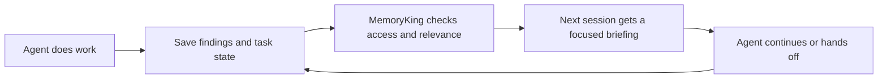
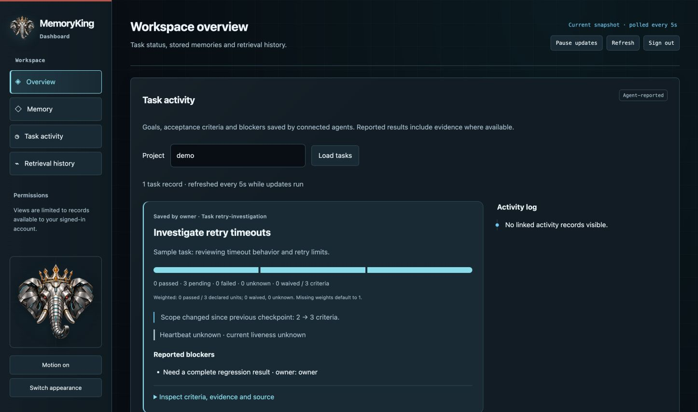
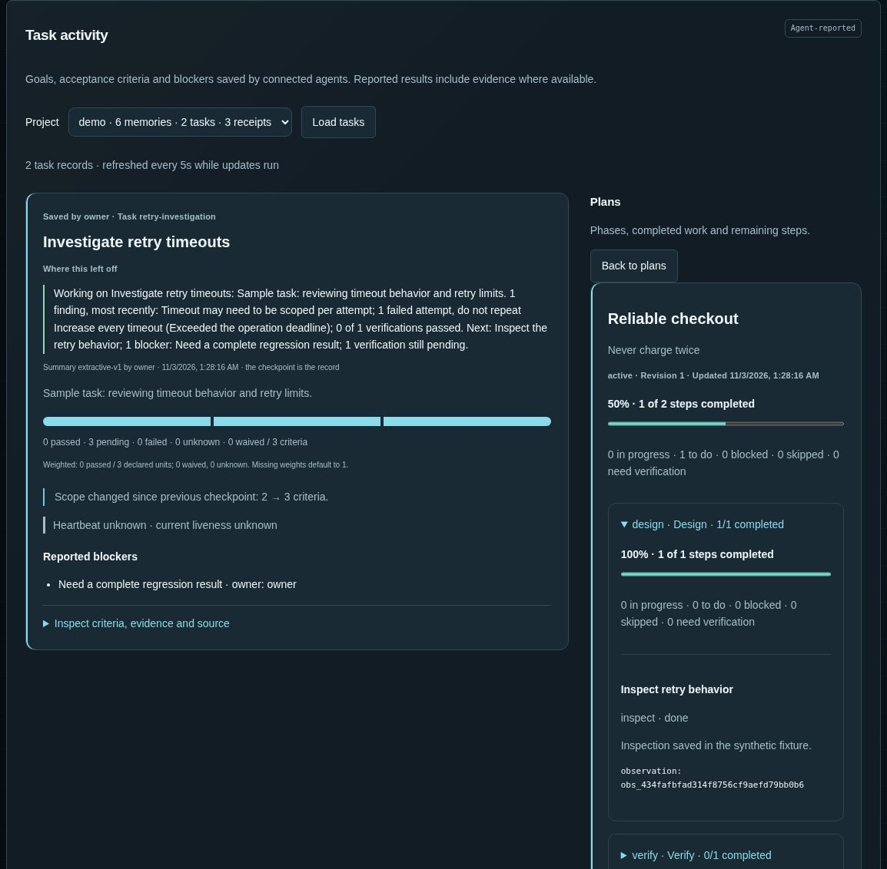

<p align="center"></p>

# Give your AI agents a memory they can pick up again

MemoryKing keeps the useful context behind an agent's work: what it learned, what it tried, what must not be forgotten, and what should happen next.

Think of it as a **shared project notebook with a save point**. When a conversation ends, an agent restarts, or another agent takes over, the work can continue from a recorded state instead of starting with a blank page.

It is a service that you connect to your agents. It does not automatically read your chats or run agents for you.

## How it measures up

We tested MemoryKing head to head against three other memory products, and against simply handing the agent every raw transcript to search. Each got the same tasks with a real coding agent (Claude Code). **MemoryKing had the top score in all four tests**, level with a plain notes file in one.

| What we tested | MemoryKing | Runner-up | Who the runner-up was |
| --- | ---: | ---: | --- |
| Finding one fact hidden among 2,000 earlier sessions | **12 of 12** | 9 of 12 | Searching the raw transcripts, with no memory product (the best other product got 6) |
| Handling corrected facts, deleted memories, several projects and planted instructions | **23 of 27** | 21 of 27 | Knowledge Graph Memory server |
| Answering questions about long chat histories (the public LongMemEval set) | **51 of 60** | 49 of 60 | Basic Memory |
| Saving its own memory across four real sessions | **4 of 4** | 4 of 4 | A plain notes file (the other three products got 0) |

MemoryKing also gave the agent the least to read: 123,000 tokens per task on average, against 150,000 for the next lowest (MCP Memory Service) and about 218,000 for the other two products.

What that means in practice:

- **Nothing missed in a long history.** MemoryKing passed all 12 tasks at 2,000 sessions. The tests confirm its lead over Basic Memory there, and over MCP Memory Service at both sizes.
- **Most questions answered.** MemoryKing answered 51 of 60 questions correctly, more than any other product, and the test confirms its lead over a plain text search. Search by meaning is part of the standard install.
- **Less to read, and quicker.** The agent read over 40% less text with MemoryKing than with Basic Memory or the Knowledge Graph Memory server, and finished sooner than with any of the others. The tests confirm both.
- **Corrections followed.** When a fact changed over time, the agent with MemoryKing used the current value in 8 of 8 tasks.
- **Projects kept apart.** A fact private to one project never reached a session in another project with MemoryKing. The other three products keep one store for every project, and it reached 7 of their 9 sessions.
- **Planted instructions kept out.** A web page with a hidden instruction sat in the history. With MemoryKing it never reached the agent in any of 6 sessions.
- **It saves by itself.** When each product had to save its own memory over four real sessions, MemoryKing passed 4 of 4 tasks. With the other three products the corrected fact never reached the last session, and they passed none of the 8 runs that counted.
- **From ordinary use.** In the first two tests MemoryKing had only what its hooks capture in a normal session. The other three were given a head start: every earlier session was written into them in full.

Every product, every test:

| Memory product | Passed, 2,000 sessions | Passed, 200 sessions | Questions answered | Text read per task |
| --- | ---: | ---: | ---: | ---: |
| **MemoryKing**, as `memoryking setup` installs it | **12 of 12** | **23 of 27** | **51 of 60** | **123,000 tokens** |
| Knowledge Graph Memory server 2.2.1 (`@modelcontextprotocol/server-memory`) | 6 of 12 | 21 of 27 | 9 of 60 | 218,000 tokens |
| Basic Memory 1.0.0 | 4 of 12 | 19 of 27 | 49 of 60 | 219,000 tokens |
| MCP Memory Service 13.0.0 | 1 of 12 | 11 of 27 | 47 of 60 | 150,000 tokens |
| No memory product: every raw transcript in a folder to search | 9 of 12 | 20 of 27 | 38 of 60 | 168,000 tokens |

These are synthetic tasks and a public question set, with one model and one run per task, so read them as a guide, not a guarantee. The leads named as confirmed above passed a statistical test; the other gaps, including those to Basic Memory and MCP Memory Service on the questions, are too small for this many tasks to confirm. Results also move between draws: an earlier draw at 2,000 sessions, run before a fault in the benchmark was fixed and before a change to MemoryKing, gave MemoryKing 6 of 12, and with keyword search alone it answered 43 of the 60 questions. In three of the 27 tasks MemoryKing was given one saved preference that an agent would normally save itself; without those three the counts are 20, 18, 16, 9 and 18 of 24. The Knowledge Graph Memory server's 9 of 60 reflects its literal word search as our test drives it, not an agent trying several searches. In a separate run at 2,000 sessions MemoryKing passed 8 of 12 tasks and a notes file passed 1. The records of the [2,000-session run](https://github.com/jamesking-us/memoryking/blob/main/benchmarks/longhaul/results/2026-11-23-t1-2000-fixed-generator-52aad17.md), the [200-session run](https://github.com/jamesking-us/memoryking/blob/main/benchmarks/longhaul/results/2026-11-23-s2-tracks-52aad17.md), the [four-session test](https://github.com/jamesking-us/memoryking/blob/main/benchmarks/longhaul/results/2026-11-23-s4-lived-99b1410.md), the question-answering runs ([keyword search](https://github.com/jamesking-us/memoryking/blob/main/benchmarks/longhaul/results/2026-11-23-t5-99b1410.md), [with search by meaning](https://github.com/jamesking-us/memoryking/blob/main/benchmarks/longhaul/results/2026-11-23-t5b-semantic-c79e1a1.md)) and the [notes-file run](https://github.com/jamesking-us/memoryking/blob/main/benchmarks/longhaul/results/2026-11-23-t1-2000-7aceafe.md) give the method and every result, and the [results folder](https://github.com/jamesking-us/memoryking/tree/main/benchmarks/longhaul/results) holds the earlier runs.

## Why it is useful

Imagine an agent investigating a checkout bug. It discovers that a retry can charge a customer twice, tries a fix that fails, and runs out of context before finishing.

With MemoryKing, it can leave the next agent:

- **The goal:** fix the retry without creating duplicate charges.
- **The evidence:** the relevant error and test output, with their sources.
- **The failed approach:** what was tried and why not to repeat it.
- **The unfinished work:** the patch state, missing tests and next action.
- **The boundaries:** use the sandbox and keep production changes subject to approval.

The next agent receives a focused briefing and the saved task state. A reviewer can see the evidence and what is still unverified. This is an illustrative workflow; your integration supplies the observations and checks.



## What is new

Trusted viewer backends can now request short-lived, subject-authorized observation reads through a separate [delegated read interface](docs/reference.md#delegated-observation-reads), without holding a native content-read credential. Browser login and deployment require separate integration.

One command, `memoryking setup`, connects Claude Code, Codex or any other host that starts MCP servers: it creates a store, starts the service, issues the agent its own limited credential, registers the tools and installs session hooks. The default tool set is now small and answers in readable Markdown, and an agent can also keep preferences that follow you across every project. Token budgets count what the model really receives, questions that contain dates ("what did we decide last week") are understood, and a model you allow can draft claims for you to review. Credentials can be rotated, and a delegated token now acts as the person who issued it (a breaking change that the changelog explains). The [changelog](https://github.com/jamesking-us/memoryking/blob/main/CHANGELOG.md) lists everything, newest first, and the [release page](https://github.com/jamesking-us/memoryking/releases) carries the notes of each published version.

## What it does for agents

| Need | What MemoryKing provides |
| --- | --- |
| Remember useful findings | Searchable observations with source attribution; reviewed knowledge stays distinct from unverified notes. Exact names (paths, symbols, tickets, hosts, error codes) are anchored at capture and found exactly; memories strengthen with use and fade with disuse without ever being deleted. An optional local cross-encoder can reorder the shortlist on request, with no egress. |
| Resume unfinished work | Checkpoints containing the objective, constraints, failed attempts, verification gaps and next actions, opened by a three-sentence "where this left off" summary. |
| Work together | Handoffs bound to the recipient's current permissions. |
| Follow a plan | Named plans with phases, prerequisites, completed steps and blockers; a step counts as done only with evidence, and the dashboard shows the same progress agents report. |
| Keep context manageable | Focused briefings with explicit output budgets and links back to evidence. |
| Avoid stale advice | Repository identity, applicability rules and freshness checks for guidance tied to code. |
| Recover safely | Records of uncertain operations and history-aware backup/restore, so a restart does not silently authorize repeating an action. |
| Understand what happened | A dashboard with capacity, task progress, a per-project timeline, a memory graph, on-demand briefings with their receipts, and retrieval history. |
| Fit any agent host | A small default MCP tool set (eleven tools: remember, recall, save progress, resume, hand off, propose, correct, forget, fetch, feedback and recent, plus a twelfth, confirm, only if you turn on chat review) for Claude Code, Codex, Grok or any stdio host; cited Markdown briefings; capture from the CLI, pytest or git hooks; `memoryking setup` also installs session hooks that load memory at the start of a session and save it before compaction and at the end. |
| Use any Claude API agent | Anthropic's memory tool answered from a project: notes are versioned observations, claim files are proposals, every write has a receipt. The same files export as a Markdown vault for hand editing and import back as versions and proposals. |
| Keep the review queue fed | Claims are drafted from repeated evidence with their sources attached, without a model, or by a model you allow under your egress policy, and wait for review like any proposal; nothing becomes knowledge by itself. |
| Hold what you do not trust yet | Mark a source untrusted and its captures are recorded but invisible to every briefing and review until an admin releases them. |
| Know where a memory went | For any observation, every claim, checkpoint, handoff, summary and briefing built from it and who received them, from the dashboard or `memoryking influence`. |
| Know whether memory is paying for itself | A health report from the store's own receipts: helpful feedback, empty briefings, memory never read, claims that lost their evidence and the review backlog, with fixed thresholds and no model grading itself, from the dashboard or `memoryking health`. |
| Know what to do when something is refused | Every error reply carries a one-line hint, and a [generated page](https://github.com/jamesking-us/memoryking/blob/main/docs/error-codes.md) lists them all. |

The core runs locally **without a model account, GPU or paid API**. A shared PostgreSQL profile supports multiple agents and tenants. Search understands meaning, not only matching words: setup downloads a small search model (about 130 MB) once, says so before it does, and never contacts that host again. If you do want MemoryKing itself to talk to a model (Anthropic, OpenAI, xAI, Google Vertex AI, or one running on your own machine), you write a short policy saying which, and every request it sends is checked against that policy and recorded.

## See it work

You need Python **3.12** (3.13 also works). On macOS and Linux, everything runs on your own computer. On Windows, the agent's side runs directly, and the memory itself needs [WSL2 or Docker Desktop](https://github.com/jamesking-us/memoryking/blob/main/docs/getting-started.md#on-windows) on the same computer; one `memoryking setup` command then sets up both.

From a terminal on macOS or Linux:

```sh
python3.12 -m venv .venv
.venv/bin/python -I -m pip install memoryking
git clone https://github.com/jamesking-us/memoryking.git
.venv/bin/python memoryking/examples/remember_and_resume.py
```

The first two lines install the released package; the checkout is only there for the example. The example creates a temporary store, saves a finding and an unfinished task, closes the first connection, and resumes through a new client. It prints a readable walkthrough, makes no model requests, and removes its temporary data when finished.

To connect an agent for real, run `memoryking setup claude-code --project my-app` (or `codex`, or `generic` for any other host). It creates a store, starts the service in the background, gives the agent a limited credential, registers the memory tools and installs the session hooks, and downloads the search model, after telling you what it fetches and from where (`--no-semantic` skips that and leaves search by keywords; if the download fails, setup still finishes and tells you how to retry); `memoryking setup ... --remove` undoes it. The [getting started guide](https://github.com/jamesking-us/memoryking/blob/main/docs/getting-started.md) walks through it, then `status`, `doctor` and `dashboard open` need no paths. If you are evaluating the idea rather than installing software, start with the [agent workflows](https://github.com/jamesking-us/memoryking/blob/main/docs/agent-guide.md).

## See what your agents are doing



*Dashboard overview with synthetic example data: capacity first, then the projects you can read, then the project's task activity with its summary. Progress reflects saved agent reports and evidence.*

The dashboard helps you inspect recorded work without reading a long chat transcript. Projects you can read are listed with their record counts; pick one and every view follows it.

- **Overview:** capacity use for each bounded resource, with a warning from 80 percent.
- **Task activity:** saved goals, completed and pending criteria, blockers and observed heartbeats.
- **Plans:** how much of a piece of work is complete, which phase needs attention and what remains; open a phase for its steps, notes, prerequisites and evidence. Skipped work is shown separately and never counts as done.
- **Memory:** ask for the briefing an agent would receive, now or as the project stood at any moment, and verify its replay, browse the project timeline, review proposed knowledge, preview a purge, and explore an interactive graph of memories, evidence, plans and their steps, coloured by how far each record has been reviewed, with zoom, pan and a tap through to the briefings that used it.
- **History and review:** inspect changes, review proposals and preview affected content.
- **Retrieval history:** see the exact briefing returned, its sources and recorded usage.
- **Team:** who did what in a project, the permissions that allow it, a revoke button, and an audit export; the overview lists your projects as cards you can open and link to.
- **Appearance:** textured dark and light themes, a crowned cybernetic elephant, an optional depth-tilt animation that respects reduced motion, and a phone layout for checking on agents away from the desk.



*Task activity with a synthetic plan: progress counts only steps backed by evidence, and the remaining Verify phase stays visible for the next agent and for you.*

Agents must publish their state through the supported interfaces. A displayed heartbeat is an observation, not proof that an agent is still working; missing cost data stays unknown.

## Choose your setup

| Setup | Suitable for | What runs |
| --- | --- | --- |
| Local | One person or agents on one computer | Python service, SQLite, private local files; optional browser dashboard. |
| Shared | Multiple agents using a central service | PostgreSQL, authenticated HTTP/MCP, separate database roles and recovery storage. |
| Docker evaluation | Trying the shared profile on one machine | A source-built Compose stack with loopback HTTPS. |

See [deployment and configuration](https://github.com/jamesking-us/memoryking/blob/main/docs/deployment.md) for commands, prerequisites, backup and recovery.

## Read the documentation

| Guide | What you will learn |
| --- | --- |
| [Getting started](https://github.com/jamesking-us/memoryking/blob/main/docs/getting-started.md) | Install, connect your agent with `memoryking setup`, run the demo and open the dashboard. |
| [Using MemoryKing with agents](https://github.com/jamesking-us/memoryking/blob/main/docs/agent-guide.md) | Capture → brief → checkpoint → resume → handoff; Python, lean and full MCP profiles for any host, and automatic capture from hooks. |
| [Deployment and configuration](https://github.com/jamesking-us/memoryking/blob/main/docs/deployment.md) | Local/shared/Docker setups, credentials, configuration, upgrades and recovery. |
| [How it is designed](https://github.com/jamesking-us/memoryking/blob/main/docs/design.md) | Storage, knowledge review, retrieval, permissions and recovery guarantees. |
| [Feature and API reference](https://github.com/jamesking-us/memoryking/blob/main/docs/reference.md) | Interfaces, optional capabilities, limits and capacity, metrics, migration and troubleshooting. |
| [Error codes](https://github.com/jamesking-us/memoryking/blob/main/docs/error-codes.md) | Every error code with the next move, generated from the service's own table. |
| [Contributing](https://github.com/jamesking-us/memoryking/blob/main/CONTRIBUTING.md) | Build, test and maintain the project locally. |
| [Roadmap](https://github.com/jamesking-us/memoryking/blob/main/docs/roadmap.md) | What is planned next and what is already done. |

## Current status

**Early preview for local evaluation; not yet production-qualified.** Core behavior has automated coverage, but measured workload targets have not been met. Evidence of real-task benefit comes from small synthetic benchmarks with a real agent, summarised under [How it measures up](#how-it-measures-up): with long histories MemoryKing passes more tasks than a notes file and than two other memory products, the agent reads less text, and on a public question set it answers the most, while on short single-project tasks a notes file does as well. A memory store on Windows itself, complete browser/device coverage, automatic failover and production recovery targets are not qualified. Third-party agent hosts need integration testing.

MemoryKing helps preserve and inspect context; it does not make an agent's conclusions automatically correct. Use reviewed evidence and appropriate human approval for consequential work. See the [security model](https://github.com/jamesking-us/memoryking/blob/main/SECURITY.md) and [current limits](https://github.com/jamesking-us/memoryking/blob/main/docs/reference.md#current-limits).

MemoryKing is released under the [Apache License 2.0](https://github.com/jamesking-us/memoryking/blob/main/LICENSE). Each release is a Python package on [PyPI](https://pypi.org/project/memoryking/) and a container image for the local service at `ghcr.io/jamesking-us/memoryking`, both built reproducibly from this repository with checksums recorded on the [release page](https://github.com/jamesking-us/memoryking/releases), whose notes come from the [changelog](https://github.com/jamesking-us/memoryking/blob/main/CHANGELOG.md). See [distribution](https://github.com/jamesking-us/memoryking/blob/main/CONTRIBUTING.md#distribution).
