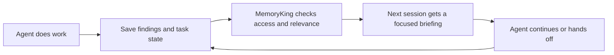
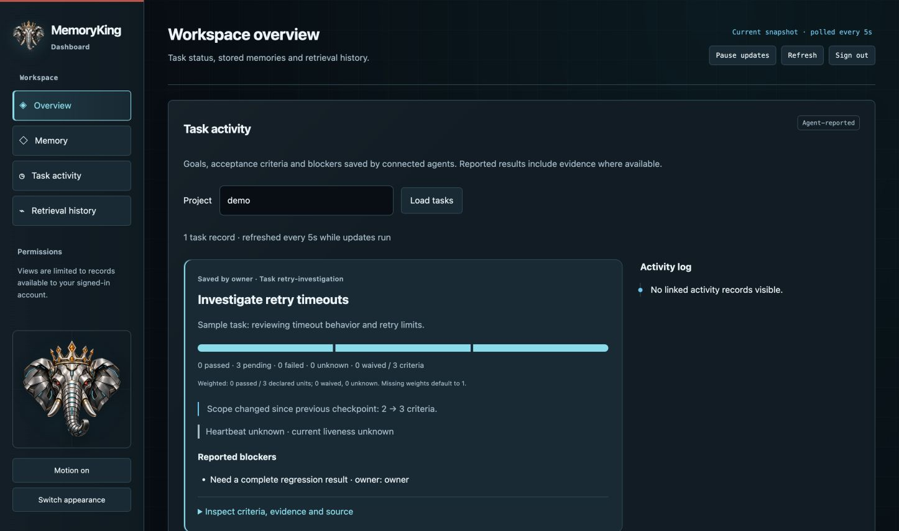
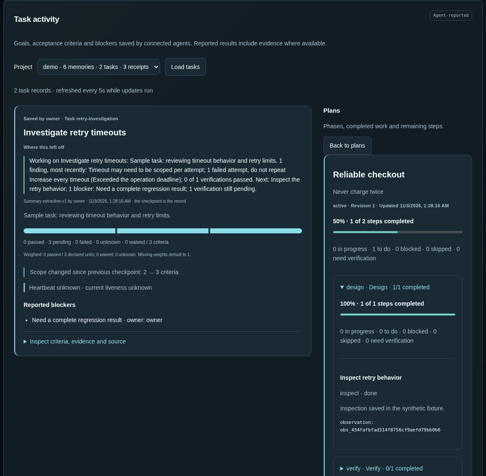

<p align="center"></p>

# Give your AI agents a memory they can pick up again

MemoryKing keeps the useful context behind an agent's work: what it learned, what it tried, what must not be forgotten, and what should happen next.

Think of it as a **shared project notebook with a save point**. When a conversation ends, an agent restarts, or another agent takes over, the work can continue from a recorded state instead of starting with a blank page.

It is a service that you connect to your agents. It does not automatically read your chats or run agents for you.

## Why it is useful

Imagine an agent investigating a checkout bug. It discovers that a retry can charge a customer twice, tries a fix that fails, and runs out of context before finishing.

With MemoryKing, it can leave the next agent:

- **The goal:** fix the retry without creating duplicate charges.
- **The evidence:** the relevant error and test output, with their sources.
- **The failed approach:** what was tried and why not to repeat it.
- **The unfinished work:** the patch state, missing tests and next action.
- **The boundaries:** use the sandbox and keep production changes subject to approval.

The next agent receives a focused briefing and the saved task state. A reviewer can see the evidence and what is still unverified. This is an illustrative workflow; your integration supplies the observations and checks.



## What it does for agents

| Need | What MemoryKing provides |
| --- | --- |
| Remember useful findings | Searchable observations with source attribution; reviewed knowledge stays distinct from unverified notes. |
| Resume unfinished work | Checkpoints containing the objective, constraints, failed attempts, verification gaps and next actions, opened by a three-sentence "where this left off" summary. |
| Work together | Handoffs bound to the recipient's current permissions. |
| Follow a plan | Named plans with phases, prerequisites, completed steps and blockers; a step counts as done only with evidence, and the dashboard shows the same progress agents report. |
| Keep context manageable | Focused briefings with explicit output budgets and links back to evidence. |
| Avoid stale advice | Repository identity, applicability rules and freshness checks for guidance tied to code. |
| Recover safely | Records of uncertain operations and history-aware backup/restore, so a restart does not silently authorize repeating an action. |
| Understand what happened | A dashboard with capacity, task progress, a per-project timeline, a memory graph, on-demand briefings with their receipts, and retrieval history. |
| Fit any agent host | A lean five-tool MCP profile with defaults for Claude Code, Codex, Grok or any stdio host; cited Markdown briefings; capture from the CLI, pytest or git hooks. |
| Know what to do when something is refused | Every error reply carries a one-line hint, and a [generated page](https://github.com/jamesking-us/memoryking/blob/main/docs/error-codes.md) lists them all. |

The core runs locally **without a model account, GPU or paid API**. A shared PostgreSQL profile supports multiple agents and tenants. Optional local embeddings add semantic search. If you do want MemoryKing itself to talk to a model (Anthropic, OpenAI, xAI, Google Vertex AI, or one running on your own machine), you write a short policy saying which, and every request it sends is checked against that policy and recorded.

## See it work

You need Python **3.12**. From a terminal:

```sh
python3.12 -m venv .venv
.venv/bin/python -I -m pip install --pre memoryking
git clone https://github.com/jamesking-us/memoryking.git
.venv/bin/python memoryking/examples/remember_and_resume.py
```

The first two lines install the released package (`--pre` because the current release is a preview); the checkout is only there for the example. The example creates a temporary store, saves a finding and an unfinished task, closes the first connection, and resumes through a new client. It prints a readable walkthrough, makes no model requests, and removes its temporary data when finished.

For a lasting installation and the browser dashboard, follow the [getting started guide](https://github.com/jamesking-us/memoryking/blob/main/docs/getting-started.md): name your store once with `memoryking profile add`, then `status`, `doctor`, `dashboard open` and `credential issue` need no paths. If you are evaluating the idea rather than installing software, start with the [agent workflows](https://github.com/jamesking-us/memoryking/blob/main/docs/agent-guide.md).

## See what your agents are doing



*Dashboard overview with synthetic example data: capacity first, then the projects you can read, then the project's task activity with its summary. Progress reflects saved agent reports and evidence.*

The dashboard helps you inspect recorded work without reading a long chat transcript. Projects you can read are listed with their record counts; pick one and every view follows it.

- **Overview:** capacity use for each bounded resource, with a warning from 80 percent.
- **Task activity:** saved goals, completed and pending criteria, blockers and observed heartbeats.
- **Plans:** how much of a piece of work is complete, which phase needs attention and what remains; open a phase for its steps, notes, prerequisites and evidence. Skipped work is shown separately and never counts as done.
- **Memory:** ask for the briefing an agent would receive and verify its replay, browse the project timeline, review proposed knowledge, preview a purge, and explore an interactive graph of memories and evidence, coloured by how far each record has been reviewed, with a tap through to the briefings that used it.
- **History and review:** inspect changes, review proposals and preview affected content.
- **Retrieval history:** see the exact briefing returned, its sources and recorded usage.
- **Team:** who did what in a project, the permissions that allow it, a revoke button, and an audit export; the overview lists your projects as cards you can open and link to.
- **Appearance:** textured dark and light themes, a crowned cybernetic elephant, an optional depth-tilt animation that respects reduced motion, and a phone layout for checking on agents away from the desk.



*Task activity with a synthetic plan: progress counts only steps backed by evidence, and the remaining Verify phase stays visible for the next agent and for you.*

Agents must publish their state through the supported interfaces. A displayed heartbeat is an observation, not proof that an agent is still working; missing cost data stays unknown.

## Choose your setup

| Setup | Suitable for | What runs |
| --- | --- | --- |
| Local | One person or agents on one computer | Python service, SQLite, private local files; optional browser dashboard. |
| Shared | Multiple agents using a central service | PostgreSQL, authenticated HTTP/MCP, separate database roles and recovery storage. |
| Docker evaluation | Trying the shared profile on one machine | A source-built Compose stack with loopback HTTPS. |

See [deployment and configuration](https://github.com/jamesking-us/memoryking/blob/main/docs/deployment.md) for commands, prerequisites, backup and recovery.

## Read the documentation

| Guide | What you will learn |
| --- | --- |
| [Getting started](https://github.com/jamesking-us/memoryking/blob/main/docs/getting-started.md) | Install, run the demo, create a store and open the dashboard. |
| [Using MemoryKing with agents](https://github.com/jamesking-us/memoryking/blob/main/docs/agent-guide.md) | Capture → brief → checkpoint → resume → handoff; Python, lean and full MCP profiles for any host, and automatic capture from hooks. |
| [Deployment and configuration](https://github.com/jamesking-us/memoryking/blob/main/docs/deployment.md) | Local/shared/Docker setups, credentials, configuration, upgrades and recovery. |
| [How it is designed](https://github.com/jamesking-us/memoryking/blob/main/docs/design.md) | Storage, knowledge review, retrieval, permissions and recovery guarantees. |
| [Feature and API reference](https://github.com/jamesking-us/memoryking/blob/main/docs/reference.md) | Interfaces, optional capabilities, limits and capacity, metrics, migration and troubleshooting. |
| [Error codes](https://github.com/jamesking-us/memoryking/blob/main/docs/error-codes.md) | Every error code with the next move, generated from the service's own table. |
| [Contributing](https://github.com/jamesking-us/memoryking/blob/main/CONTRIBUTING.md) | Build, test and maintain the project locally. |

## Current status

**Early preview for local evaluation; not yet production-qualified.** Core behavior has automated coverage, but measured workload targets have not been met. Improved real-task success or reduced token cost has not yet been demonstrated. Windows, complete browser/device coverage, automatic failover and production recovery targets are not qualified. Third-party agent hosts need integration testing.

MemoryKing helps preserve and inspect context; it does not make an agent's conclusions automatically correct. Use reviewed evidence and appropriate human approval for consequential work. See the [security model](https://github.com/jamesking-us/memoryking/blob/main/SECURITY.md) and [current limits](https://github.com/jamesking-us/memoryking/blob/main/docs/reference.md#current-limits).

MemoryKing is released under the [Apache License 2.0](https://github.com/jamesking-us/memoryking/blob/main/LICENSE). Each release is a Python package on [PyPI](https://pypi.org/project/memoryking/) and a container image for the local service at `ghcr.io/jamesking-us/memoryking`, both built reproducibly from this repository with checksums recorded on the [release page](https://github.com/jamesking-us/memoryking/releases). See [distribution](https://github.com/jamesking-us/memoryking/blob/main/CONTRIBUTING.md#distribution).
