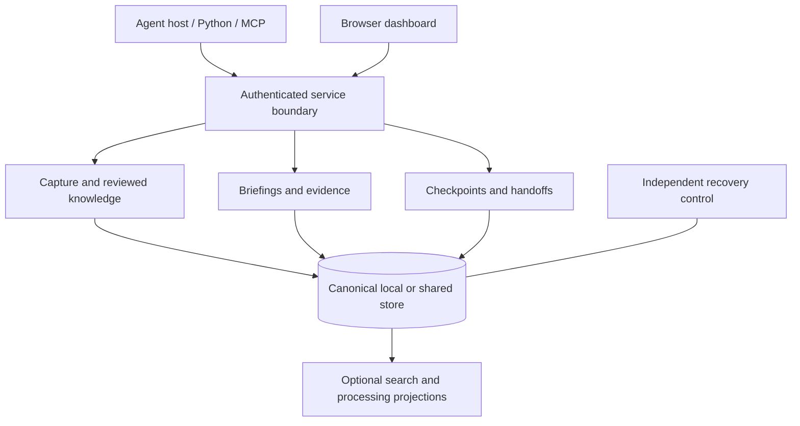

# How MemoryKing is designed

MemoryKing separates **what was observed**, **what has been accepted as guidance**, and **what an agent was doing**. That separation makes memory inspectable and prevents a saved sentence from quietly becoming an instruction or permission.

## The main pieces



The Python domain layer contains contracts and decisions independent of vendors. Application services coordinate them; adapters implement storage, transports, repository inspection and optional providers. TypeScript implements the browser interface and generated client contracts.

Storage sits behind one port. The store's operations (authorization, capture, reads, grants, purge policy, idempotent retries, jobs, context, status) are written once in the application layer in portable SQL, and each backend supplies what differs: the connection and transaction discipline, the control tree and token signing, and a small dialect for the two expressions the engines spell differently (full-text match and byte length). SQLite and PostgreSQL both implement that port; neither subclasses the other, and the PostgreSQL facade refuses engine-specific syntax rather than translating it, so a new divergence fails a test instead of hiding in a rewrite rule.

## Three kinds of memory

| Kind | Meaning | Important distinction |
| --- | --- | --- |
| Observation | An attributed event or captured source text. | It says what was recorded, not that the interpretation is correct. |
| Reviewed knowledge | A versioned claim or constraint linked to source evidence. | Proposals require authorized review before becoming accepted guidance. |
| Working state | A checkpoint of an unfinished task and its operations. | Pending tests and uncertain actions remain pending or uncertain after resume. |

A session summary is a derived artifact: three sentences composed from a checkpoint and counts of what happened since, with its own receipt, shown first on resume and on the dashboard. It is a convenience, never evidence; the checkpoint it summarizes stays the record, and a model-written summary is admitted only when it is the exact audited reply.

Procedures extend reviewed knowledge into reusable steps. Activation is a separate authorized decision. Outcomes and feedback are attributed records; they do not automatically prove effectiveness or promote a procedure.

## Local and shared storage

The local profile uses one SQLite store per tenant, SQLite WAL with full synchronization, private content files and a Unix socket. One OS owner controls a store. Multiple machines must not write the SQLite files over a shared filesystem.

The shared profile uses native PostgreSQL, tenant-scoped transaction ordering and isolated migration/runtime/worker/backup roles. HTTP and MCP clients share the same authorization and domain rules, and the same store operations as the local profile, through the storage port above. Tenant-wide ordering simplifies correctness but can create contention; the current implementation has not met its proposed workload targets.

An independent control tree records signing identity, recovery anchors and policy/deletion history. It is deliberately separate from ordinary content backups.

## How a briefing is assembled

1. Authenticate the caller and bind its tenant, project and current history.
2. Resolve mandatory constraints completely within explicit bounds.
3. Find relevant accessible observations and accepted guidance, using lexical retrieval by default and configured optional channels when available.
4. Check applicability, repository freshness, evidence visibility and conflicts.
5. Fit the complete response into the requested budget, preserving essential fields.
6. Persist the authorization decision and response identity before releasing bytes.

The result includes a status, guidance/evidence references and usage information. An unresolved essential constraint blocks rather than disappearing from a top-k list. Unknown token usage is not counted as zero; a byte estimate is labeled as an estimate.

Receipts preserve how a response was assembled. **Replay** returns retained exact response bytes if current authorization still permits it. **Rerun** performs a new retrieval and creates a new receipt. Neither operation implies a model response will be identical.

## Applicability and time

Knowledge can be limited to repositories, paths, environments, roles, task stages, dependency versions and commits. Selector v1 is a bounded OR of AND clauses, with exact sets, path-segment predicates, numeric version intervals and trusted commit ancestry. Arbitrary executable predicates, path globs and unproven ancestry do not enter this decision path.

Evaluation has three outcomes: true, false or unknown. Missing inputs do not silently mean “does not apply.” Unknown essential policy blocks. Partial replacement must be provably contained in the original and replacement claim's scope.

Valid time describes when a claim applies. Recorded position describes when the system learned or changed it. Historical inspection preserves that distinction while still applying today's permissions, purge and quarantine rules.

## Authorization and retained model context

Every private release records an authorization-evaluation instant, history, relevant policy epochs, response hash and deadline. Policy changes serialize against that decision. Validity at the evaluation instant allows the response to start within the bounded five-second window; crossing the deadline releases no old content and requires a fresh decision.

The consuming harness has an additional responsibility: check retained input before the next provider dispatch. `AuthorizedConversation` tracks authorization dependencies of source and derived messages, rebuilding permitted input or blocking dispatch after relevant changes. This protects future processing; it cannot undo prior deliveries.

Browser sessions bind identity, tenant, history and policy epoch. Private reads require current session authorization; mutations also require the configured Origin and CSRF protection. Public bootstrap assets carry no private content. The UI clears retained views after revocation, expiry or context changes.

## Provider adapters and egress

The local recording provider is the default and the only provider available without an explicit egress policy; with one, this is the single path by which retained context may leave the machine. It is built so that the store, not the host, decides what may go where, and so that every departure leaves an audit record.

### Three parts

**An adapter is small and dumb.** An adapter turns the frozen, canonical request bytes that `AuthorizedConversation` already produces into one provider call and returns the reply text. It has a name, the set of models it may be asked for, a declared destination host, whether it keeps server-side state (none of the shipped remote adapters do), and one method, `dispatch(raw) -> {content, request_hash, wire_hash, usage}`. It has no access to the store, the credential or the conversation; it cannot add, drop or reorder messages, because the mapping from the canonical request to the provider's wire body is a fixed function per adapter and the hash of the wire body is recorded. Three adapters ship: `anthropic-messages` (the Anthropic Messages API), `openai-chat` (chat completions, which also covers xAI Grok and self-hosted servers such as Ollama at an explicit loopback host) and `vertex-ai` (Google Cloud Vertex AI: Gemini through `generateContent`, or Anthropic models through `rawPredict`, with a bearer token from a file or an operator-named command). All use the standard library's HTTPS client with certificate verification, one attempt, a bounded timeout and a bounded response size. No retry, no streaming, no tool use, no prompt-caching handles in this revision.

**The egress policy is the operator's, and the daemon enforces it.** A private policy file names the adapters an installation may use and the limits on each:

```toml
revision = "team-2026-10"            # with a digest of this file's content, becomes the binding's egress_policy_revision
[[providers]]
name = "anthropic-messages"
host = "api.anthropic.com"
models = ["claude-sonnet-5-5"]
key_file = "/private/anthropic.key"
max_classification = "internal"      # restricted content never leaves
max_request_bytes = 98304
```

`serve --egress-policy FILE` loads it; without the flag the daemon behaves exactly as today. The policy is enforced where it cannot be skipped: the `authorize` and `consume` actions of the inference contract. The daemon checks that the request's provider and model are listed, that the binding's `egress_policy_revision` is the loaded one: the operator's `revision` label followed by a 16-hex-digit digest of the policy content, so any change to the file, even without a new label, retires every open conversation, like a permission change, that the request is within the byte limit, and that every message's provenance is within the classification ceiling. Host-authorized segments carry their classification already; for memory segments the daemon resolves the receipt's recorded dependencies to their observations and takes the highest classification among them. A packet that cites a restricted source is refused for a provider whose ceiling is `internal`, with `egress_classification_denied`, before any permit is issued. The key file is read by the host process that runs the adapter, never by the daemon, and never appears in any record.

**Every manifest is audited.** When a permit is consumed the daemon writes an egress audit record: tenant, principal, project, provider, model, destination host, request hash, manifest hash, the segment manifest itself (origins, hashes, receipt ids and authorization ids, which is already content-free), highest classification, byte count, evaluated and deadline instants. After the provider answers, the host reports the outcome through the `report` action: wire hash, response hash, provider usage and a status of `delivered` or `failed`; a conversation that dies between consume and report leaves the record `pending`, which is the truth. Records carry no content and are not purged by source purge, because the delivery happened; they expire with the usage retention (30 days) and are listed by the `audit` action, `memoryking egress-audit --project P` and the dashboard's Jobs & health view. The audit is the answer to "what left this machine, when, citing what, and did it arrive".

### What stays the same

`AuthorizedConversation` keeps its guarantees unchanged: one frozen byte string per dispatch, authorize then consume then dispatch inside the five-second window, a full revalidation of the derived closure before the reply is admitted, and rebuild-or-block after a revocation or purge. It gains one check: the adapter's name, models and host must match an entry in the policy the daemon reported in the binding, else `provider_not_supported` as today. Memory still enters as user-role content; retrieved text is never a system instruction. The model-facing MCP tools still cannot reach the inference surface.

### What this does not promise

A host holding an `inference` credential can always copy bytes elsewhere by its own code; the policy governs what the store will authorize and record, not what an unreviewed process does. Delivery cannot be recalled: revocation and purge control future dispatches and the audit shows which past dispatches cited a source. Provider-side retention, training use and logging are the provider's terms, not MemoryKing's. The contract change (`provider` and `model` widened from constants to a bounded vocabulary and pattern, `egress_policy_revision` from a constant to an identifier, plus the `report` and `audit` actions) is additive: every existing local-recording request stays valid byte for byte.

## Retries and recovery

A request namespace and idempotency key bind a mutation to its canonical payload and history. Equal retries can reuse the recorded result; changed input conflicts. Expired result bodies leave consumed-key tombstones. Retired sources cannot be recreated by reusing their old event identity.

A restored backup creates a **new history incarnation**. Old credentials, namespaces, watermarks, leases, resumable handles and adapter bases do not silently bind to replacement history. Restore replays current independently retained revocations/deletions before reopening access. Missing control evidence keeps the store unavailable.

External tool effects need their own operation records and reconciliation. A local transaction cannot guarantee exactly-once execution of an unrelated external system.

## Optional work stays subordinate to canonical evidence

Embedding vectors, compressed summaries, graph projections and ranked procedures derive from current canonical sources. Workers receive bounded leases tied to history, source and policy. Stale completions are rejected. Disabling an optional model leaves the default lexical path available; a projection never grants authority or proves truth.

Repository inspection is passive: it records Git identity, tracked/dirty artifacts and supported source structure without executing repository code. Bounded or missing coverage stays explicit. The dashboard observes stored state and can submit authorized review actions; it does not schedule agents. An active Memory view renews itself every five seconds while visible: every read passes the current authorization gate, an unchanged result leaves the open details and graph selection in place, and a hidden tab, an expired lease, a changed session or a clock rollback clears private content rather than extending it.

## Drafting without extraction

Mem0's extraction phase is the field's answer to an empty knowledge layer: a model writes facts on every capture. The evidence-first design forbids that, so the proposal engine drafts instead of extracting. It finds names that several independent observations share, lifts the latest sentence that carries each, and files a proposal with the supporting spans attached. The claim enters the same review lifecycle as a human proposal, with its method and support recorded in its provenance, and nothing it drafts has any authority until a reviewer gives it some. The queue is never empty, and the invariant is intact.

## Anchors, salience and measurement

Three ideas from the field fit the evidence-first design once they are made deterministic. Anchors are A-MEM's links and Zep's entities without a model: exact names extracted at capture, stored beside the record, matched exactly at query time and linking records that share a rare one. Salience is the forgetting-curve literature's lesson applied as a bounded nudge rather than a rewrite: use strengthens a record, disuse lets it fade into an archival tier, and nothing is ever deleted or altered by it; an as-of view never sees it. Both are measured with a judge-free harness on LongMemEval's evidence labels, so a ranking change is a number, not an argument.

## A reranker that stays in its lane

Reranking is the one retrieval stage where a model earns a place, and the design admits it on the field's terms with MemoryKing's constraints. The cross-encoder is installed deliberately, pinned by hash, run locally and loaded from the checked bytes; it is off unless a briefing asks; it sees only the top of the fused list and only reorders it; and every decision about what may appear at all, authority, audience, policy completeness and conflict expansion, is taken before it runs and is not revisited after. Its score is reported per item and its fingerprint per receipt, so a briefing ordered by a model says so, and a replay names the model. Whether it earns its latency is a measured question, not a claim: the recall harness runs with and without it on the same corpus.

## Source trust

Claims have always had a review lifecycle: a model's proposal is quarantined until a person accepts it. Source trust applies the same idea to raw evidence. A capture from a source an admin marked untrusted is recorded in full and backed up, but held: no read, briefing, graph, resume or proposal can see it, and nothing can be built on it, until an admin releases it. The decision, like every policy, goes through the signed control journal, so a restore replays it and the policy epoch retires views made before it. The store keeps the raw evidence, because the point of quarantine is review, not loss; purge remains the way to erase.

## Memory as files

Anthropic's memory tool and the field's Markdown vaults are the same idea: memory a person or a model can read as files. MemoryKing exposes its records that way without giving up anything above. A file is the newest version of an observation with its provenance on top; an edit is a new capture, not a rewrite, so the evidence trail is the version list; a claim file is a proposal and stays one until a reviewer accepts it; reading a file is a receipted fetch; deleting one is a purge with the same authority and the same dependency follow-through as any purge. The vault is the same files on disk, and importing it back goes through the same captures and proposals, so hand editing is one more source of evidence rather than a side door into the store.

## Where a memory went

Every delivery, checkpoint, handoff and summary records what it was built from, and a purge follows those dependencies to retire derived copies. The influence report reads the same graph without changing anything: for one observation it enumerates the claims that cite it, every record derived from it transitively, the retained deliveries that included it, and the principals those reached. It makes a security property that was only enforced, that a poisoned record can be traced and removed, visible to the owner before deciding anything. It is honest about its edges: retention expiry, exports, provider dispatches and backups are outside the recorded graph and are named as such.

## Memory health without a judge

Whether memory is paying for itself is a question other systems answer with a model grading its own retrievals. MemoryKing answers it from receipts: feedback actors reported against a receipt they verifiably received, the status each briefing recorded, the dependencies each delivery retained, the lifecycle of each claim and the age of each proposal. The health report aggregates those into counts and ratios for one project and a window, names no principal and quotes no text, and applies fixed thresholds that the reference states, so the report can be wrong only in ways a reader can check. Its edges are the retention window of deliveries, which it names: an observation that reached a briefing whose retention expired is counted as never delivered, so reach is a floor, never a claim.

## Structured execution plans

Plans are typed work records stored on task-level checkpoint streams. Stable phase and step ids preserve identity through reorderings; a bounded acyclic prerequisite graph rejects undefined or cyclic references. Each revision is immutable. Writes use the existing writer ownership, compare-and-set and history-aware retries; reads use current permissions and dependency availability. A full-plan revision records a scope change without rewriting older versions.

The pure progress calculation is shared by both stores and the dashboard. Completed work counts effective done steps against the declared scope. Skips stay distinct; unverifiable historical proof becomes unknown. The objective, the step definition and the transitive prerequisite states and evidence bind a completion's evidence, so a reopen followed by the old proof cannot turn a changed definition back into verified completion. This remains source-attributed reported work, not a substitute for an orchestrator's independent test and review gates.

## What this architecture does not establish

Passing implementation tests does not establish better real-task outcomes, cost savings, production throughput, complete browser support, automatic failover or disaster-recovery service levels. The current [feature limits](reference.md#current-limits) preserve those distinctions.

## Dashboard appearance

The dashboard uses a crowned cybernetic elephant emblem with gunmetal panels, restrained circuit-grid and brushed-metal CSS textures, and cyan accents. Content panels keep solid surfaces for legible labels and evidence. Dark and light themes share the same controls and semantic status indicators. No fonts, textures or artwork are fetched from external services at runtime.

The optional logo interaction tilts a rendered image using perspective; it is not an interactive 3D model. It runs once for 1.8 seconds when the emblem is clicked, stops when hidden or offscreen, and never runs for a visitor who prefers reduced motion; there is no separate motion setting. The compact phone layout uses the small static emblem in a sticky bar that holds the views, stacks every card in one column and shows the memory graph as a list by default; the drawing is one tap away and the page never scrolls sideways.

The memory graph encodes recorded facts only: a node's colour is the authority the store holds for it (observation, accepted, proposed, quarantined, rejected or deprecated, mandatory constraint, attestation, procedure, plan or plan step, working state), its size is the number of the viewer's own retained receipts that cited it, and selecting it lists those receipts. A structured plan appears as a plan node that declares its step nodes; a step points at the steps it depends on and at the observations it cites as proof, and a plan at its lessons, so the graph shows how recorded work rests on evidence. Layout distance carries no meaning; panning, zooming and pinching change presentation only; a refreshed view keeps the selected node or edge when it still exists; and a receipt trail is private to the principal that holds the receipts.

The main [elephant artwork](../packages/dashboard-foundation/web/elephant.png) was created with the built-in image-generation tool; its [generation prompt](images/memoryking-emblem-prompt.txt) is retained alongside the documentation. The favicon is a simplified vector mark for small sizes.

[Back to README](../README.md) · [Security](../SECURITY.md) · [Deployment](deployment.md)
