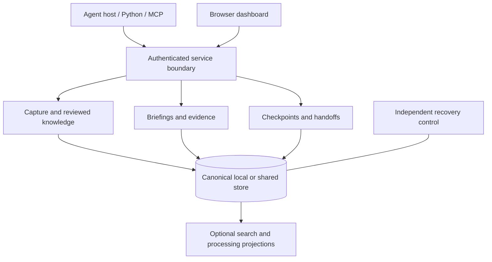

# How MemoryKing is designed

MemoryKing separates **what was observed**, **what has been accepted as guidance**, and **what an agent was doing**. That separation makes memory inspectable and prevents a saved sentence from quietly becoming an instruction or permission.

## The main pieces

The Python domain layer contains contracts and decisions independent of vendors. Application services coordinate them; adapters implement storage, transports, repository inspection and optional providers. TypeScript implements the browser interface and generated client contracts.

## Three kinds of memory

| Kind | Meaning | Important distinction |
| --- | --- | --- |
| Observation | An attributed event or captured source text. | It says what was recorded, not that the interpretation is correct. |
| Reviewed knowledge | A versioned claim or constraint linked to source evidence. | Proposals require authorized review before becoming accepted guidance. |
| Working state | A checkpoint of an unfinished task and its operations. | Pending tests and uncertain actions remain pending or uncertain after resume. |

Procedures extend reviewed knowledge into reusable steps. Activation is a separate authorized decision. Outcomes and feedback are attributed records; they do not automatically prove effectiveness or promote a procedure.

## Local and shared storage

The local profile uses one SQLite store per tenant, SQLite WAL with full synchronization, private content files and a Unix socket. One OS owner controls a store. Multiple machines must not write the SQLite files over a shared filesystem.

The shared profile uses native PostgreSQL, tenant-scoped transaction ordering and isolated migration/runtime/worker/backup roles. HTTP and MCP clients share the same authorization and domain rules. Tenant-wide ordering simplifies correctness but can create contention; the current implementation has not met its proposed workload targets.

An independent control tree records signing identity, recovery anchors and policy/deletion history. It is deliberately separate from ordinary content backups.

## How a briefing is assembled

1. Authenticate the caller and bind its tenant, project and current history.
2. Resolve mandatory constraints completely within explicit bounds.
3. Find relevant accessible observations and accepted guidance, using lexical retrieval by default and configured optional channels when available.
4. Check applicability, repository freshness, evidence visibility and conflicts.
5. Fit the complete response into the requested budget, preserving essential fields.
6. Persist the authorization decision and response identity before releasing bytes.

The result includes a status, guidance/evidence references and usage information. An unresolved essential constraint blocks rather than disappearing from a top-k list. Unknown token usage is not counted as zero; a byte estimate is labeled as an estimate.

Receipts preserve how a response was assembled. **Replay** returns retained exact response bytes if current authorization still permits it. **Rerun** performs a new retrieval and creates a new receipt. Neither operation implies a model response will be identical.

## Applicability and time

Knowledge can be limited to repositories, paths, environments, roles, task stages, dependency versions and commits. Selector v1 is a bounded OR of AND clauses, with exact sets, path-segment predicates, numeric version intervals and trusted commit ancestry. Arbitrary executable predicates, path globs and unproven ancestry do not enter this decision path.

Evaluation has three outcomes: true, false or unknown. Missing inputs do not silently mean “does not apply.” Unknown essential policy blocks. Partial replacement must be provably contained in the original and replacement claim's scope.

Valid time describes when a claim applies. Recorded position describes when the system learned or changed it. Historical inspection preserves that distinction while still applying today's permissions, purge and quarantine rules.

## Authorization and retained model context

Every private release records an authorization-evaluation instant, history, relevant policy epochs, response hash and deadline. Policy changes serialize against that decision. Validity at the evaluation instant allows the response to start within the bounded five-second window; crossing the deadline releases no old content and requires a fresh decision.

The consuming harness has an additional responsibility: check retained input before the next provider dispatch. `AuthorizedConversation` tracks authorization dependencies of source and derived messages, rebuilding permitted input or blocking dispatch after relevant changes. This protects future processing; it cannot undo prior deliveries.

Browser sessions bind identity, tenant, history and policy epoch. Private reads require current session authorization; mutations also require the configured Origin and CSRF protection. Public bootstrap assets carry no private content. The UI clears retained views after revocation, expiry or context changes.

## Retries and recovery

A request namespace and idempotency key bind a mutation to its canonical payload and history. Equal retries can reuse the recorded result; changed input conflicts. Expired result bodies leave consumed-key tombstones. Retired sources cannot be recreated by reusing their old event identity.

A restored backup creates a **new history incarnation**. Old credentials, namespaces, watermarks, leases, resumable handles and adapter bases do not silently bind to replacement history. Restore replays current independently retained revocations/deletions before reopening access. Missing control evidence keeps the store unavailable.

External tool effects need their own operation records and reconciliation. A local transaction cannot guarantee exactly-once execution of an unrelated external system.

## Optional work stays subordinate to canonical evidence

Embedding vectors, compressed summaries, graph projections and ranked procedures derive from current canonical sources. Workers receive bounded leases tied to history, source and policy. Stale completions are rejected. Disabling an optional model leaves the default lexical path available; a projection never grants authority or proves truth.

Repository inspection is passive: it records Git identity, tracked/dirty artifacts and supported source structure without executing repository code. Bounded or missing coverage stays explicit. The dashboard observes stored state and can submit authorized review actions; it does not schedule agents.

## What this architecture does not establish

Passing implementation tests does not establish better real-task outcomes, cost savings, production throughput, complete browser support, automatic failover or disaster-recovery service levels. The current [feature limits](reference.md#current-limits) preserve those distinctions.

## Dashboard appearance

The dashboard uses a crowned cybernetic elephant emblem with gunmetal panels, restrained circuit-grid and brushed-metal CSS textures, and cyan accents. Content panels keep solid surfaces for legible labels and evidence. Dark and light themes share the same controls and semantic status indicators. No fonts, textures or artwork are fetched from external services at runtime.

The optional logo interaction tilts a rendered image using perspective; it is not an interactive 3D model. It runs once for 1.8 seconds on request, stops when hidden or offscreen, and respects reduced motion and the Motion off control. The compact phone layout uses the small static emblem.

The main [elephant artwork](../packages/dashboard-foundation/web/elephant.png) was created with the built-in image-generation tool; its [generation prompt](images/memoryking-emblem-prompt.txt) is retained alongside the documentation. The favicon is a simplified vector mark for small sizes.

[Back to README](../README.md) · [Security](../SECURITY.md) · [Deployment](deployment.md)
