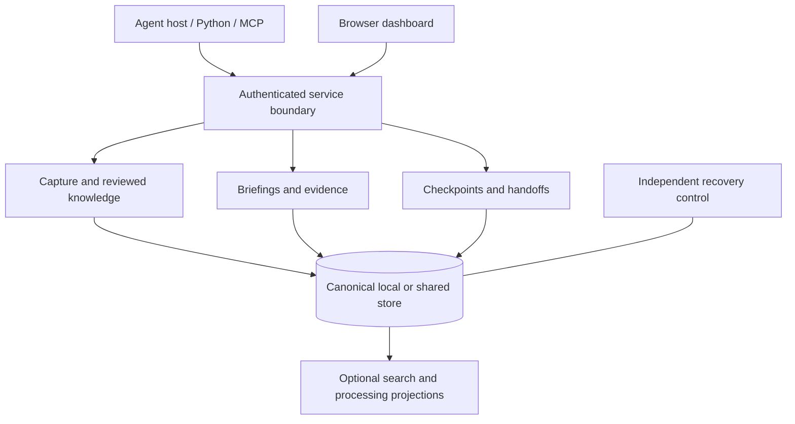

# How MemoryKing is designed

MemoryKing separates **what was observed**, **what has been accepted as guidance**, and **what an agent was doing**. That separation makes memory inspectable and prevents a saved sentence from quietly becoming an instruction or permission.

## The main pieces

The Python domain layer contains contracts and decisions independent of vendors. Application services coordinate them; adapters implement storage, transports, repository inspection and optional providers. TypeScript implements the browser interface and generated client contracts.

## Three kinds of memory

| Kind | Meaning | Important distinction |
| --- | --- | --- |
| Observation | An attributed event or captured source text. | It says what was recorded, not that the interpretation is correct. |
| Reviewed knowledge | A versioned claim or constraint linked to source evidence. | Proposals require authorized review before becoming accepted guidance. |
| Working state | A checkpoint of an unfinished task and its operations. | Pending tests and uncertain actions remain pending or uncertain after resume. |

Procedures extend reviewed knowledge into reusable steps. Activation is a separate authorized decision. Outcomes and feedback are attributed records; they do not automatically prove effectiveness or promote a procedure.

## Local and shared storage

The local profile uses one SQLite store per tenant, SQLite WAL with full synchronization, private content files and a Unix socket. One OS owner controls a store. Multiple machines must not write the SQLite files over a shared filesystem.

The shared profile uses native PostgreSQL, tenant-scoped transaction ordering and isolated migration/runtime/worker/backup roles. HTTP and MCP clients share the same authorization and domain rules. Tenant-wide ordering simplifies correctness but can create contention; the current implementation has not met its proposed workload targets.

An independent control tree records signing identity, recovery anchors and policy/deletion history. It is deliberately separate from ordinary content backups.

## How a briefing is assembled

1. Authenticate the caller and bind its tenant, project and current history.
2. Resolve mandatory constraints completely within explicit bounds.
3. Find relevant accessible observations and accepted guidance, using lexical retrieval by default and configured optional channels when available.
4. Check applicability, repository freshness, evidence visibility and conflicts.
5. Fit the complete response into the requested budget, preserving essential fields.
6. Persist the authorization decision and response identity before releasing bytes.

The result includes a status, guidance/evidence references and usage information. An unresolved essential constraint blocks rather than disappearing from a top-k list. Unknown token usage is not counted as zero; a byte estimate is labeled as an estimate.

Receipts preserve how a response was assembled. **Replay** returns retained exact response bytes if current authorization still permits it. **Rerun** performs a new retrieval and creates a new receipt. Neither operation implies a model response will be identical.

## Applicability and time

Knowledge can be limited to repositories, paths, environments, roles, task stages, dependency versions and commits. Selector v1 is a bounded OR of AND clauses, with exact sets, path-segment predicates, numeric version intervals and trusted commit ancestry. Arbitrary executable predicates, path globs and unproven ancestry do not enter this decision path.

Evaluation has three outcomes: true, false or unknown. Missing inputs do not silently mean “does not apply.” Unknown essential policy blocks. Partial replacement must be provably contained in the original and replacement claim's scope.

Valid time describes when a claim applies. Recorded position describes when the system learned or changed it. Historical inspection preserves that distinction while still applying today's permissions, purge and quarantine rules.

## Authorization and retained model context

Every private release records an authorization-evaluation instant, history, relevant policy epochs, response hash and deadline. Policy changes serialize against that decision. Validity at the evaluation instant allows the response to start within the bounded five-second window; crossing the deadline releases no old content and requires a fresh decision.

The consuming harness has an additional responsibility: check retained input before the next provider dispatch. `AuthorizedConversation` tracks authorization dependencies of source and derived messages, rebuilding permitted input or blocking dispatch after relevant changes. This protects future processing; it cannot undo prior deliveries.

Browser sessions bind identity, tenant, history and policy epoch. Private reads require current session authorization; mutations also require the configured Origin and CSRF protection. Public bootstrap assets carry no private content. The UI clears retained views after revocation, expiry or context changes.

## Retries and recovery

A request namespace and idempotency key bind a mutation to its canonical payload and history. Equal retries can reuse the recorded result; changed input conflicts. Expired result bodies leave consumed-key tombstones. Retired sources cannot be recreated by reusing their old event identity.

A restored backup creates a **new history incarnation**. Old credentials, namespaces, watermarks, leases, resumable handles and adapter bases do not silently bind to replacement history. Restore replays current independently retained revocations/deletions before reopening access. Missing control evidence keeps the store unavailable.

External tool effects need their own operation records and reconciliation. A local transaction cannot guarantee exactly-once execution of an unrelated external system.

## Optional work stays subordinate to canonical evidence

Embedding vectors, compressed summaries, graph projections and ranked procedures derive from current canonical sources. Workers receive bounded leases tied to history, source and policy. Stale completions are rejected. Disabling an optional model leaves the default lexical path available; a projection never grants authority or proves truth.

Repository inspection is passive: it records Git identity, tracked/dirty artifacts and supported source structure without executing repository code. Bounded or missing coverage stays explicit. The dashboard observes stored state and can submit authorized review actions; it does not schedule agents.

## What this architecture does not establish

Passing implementation tests does not establish better real-task outcomes, cost savings, production throughput, complete browser support, automatic failover or disaster-recovery service levels. The current [feature limits](reference.md#current-limits) preserve those distinctions.

## Dashboard appearance

The dashboard uses a crowned cybernetic elephant emblem with gunmetal panels, restrained circuit-grid and brushed-metal CSS textures, and cyan accents. Content panels keep solid surfaces for legible labels and evidence. Dark and light themes share the same controls and semantic status indicators. No fonts, textures or artwork are fetched from external services at runtime.

The optional logo interaction tilts a rendered image using perspective; it is not an interactive 3D model. Clicking the emblem runs it once for 1.8 seconds. It stops when hidden or offscreen and respects the device's reduced-motion preference. There is no separate animation control. The compact phone layout uses the small static emblem.

The owner dashboard renews the active Memory reading view every five seconds while
updates run. Every contributing query must pass current authorization before the
whole view receives another lease, capped at fifteen seconds. An unchanged view
keeps its open details and reading position; a refreshed graph retains its selected
node or edge if still present. A failed renewal, changed session/scope, clock rollback
or expired lease clears private content. Exports cannot renew unrelated content,
and mutations and destructive confirmations are never automatically replayed.

The main [elephant artwork](../packages/dashboard-foundation/web/elephant.png) was created with the built-in image-generation tool; its [generation prompt](images/memoryking-emblem-prompt.txt) is retained alongside the documentation. The favicon is a simplified vector mark for small sizes.

## Viewer identity boundary

Viewer subjects have dedicated numeric GitHub identity bindings and read-only exact
project grants. These policy operations use the existing independently durable
control journal and canonical release transactions on both stores. A restored
content archive cannot roll back a later revocation, and a new history invalidates
old contexts. Binding changes invalidate generations and never transfer content
readership.

The trusted provider adapter will resolve an authenticated subject to an internal
verified context; browser input cannot choose a principal or claim a role. The
canonical authorization path checks the signed viewer ceiling and current policy
before reading, including nested dependency checks. No owner credential is placed
in a viewer context. Owner operations stay outside model-facing discovery.

The dedicated viewer listener now implements bounded current-authorized task,
memory, graph and report reads on both stores. It has no owner or agent routes.
Opaque cursors bind session, project, policy, source frontier and history; a restore
or changed context requires a new read. Task details retain actual criterion states
and current evidence links. Missing current projections or unknown mandatory
applicability block the view. Graph edges describe actual task/criterion containment.
The node array also supports a plain list without requiring a graph renderer.

Every read commits an authorization receipt at the canonical evaluation instant.
The five-second release deadline and a separate, at-most-15-second display lease
limit completion and retention respectively. The lease ends earlier at known
permission, constraint, source and verification boundaries. A lease already expired
on arrival must be discarded by the future client. Request admission, headers,
database acquisition/query work and response sizes have bounded budgets. Timeout
or capacity loss reports unavailable, without inventing revocation.

GitHub authentication and the mobile interface remain under development. The
production session resolver denies every private request until login is implemented;
only disposable integration fixtures inject authenticated sessions. Configuration
cannot enable that fixture seam. Real desktop Chrome has exercised both stores with
direct TLS and a test HTTPS gateway; this is not physical-phone or tailnet evidence.

## Experimental report storage and rendering

The optional report modules validate a complete phase document and build PDF, EPUB
and structured reader content from the same source. Reader fragments preserve long
code and tables without exceeding 64 KiB per response. Structure checks do not
establish factual accuracy or human approval.

The native macOS renderer runs in a separate process with restricted file access,
no network, no inherited mail environment or service descriptors, and bounded wall
time and memory. Linux uses a separate fail-closed Landlock-based sandbox with
the qualified container restrictions described in the deployment guide.
SQLite and PostgreSQL store immutable report inputs, dependency references and
artifact hashes. External source bindings explicitly name permitted readers and a
classification; a Git hash or local path grants no permission. Report visibility
intersects the current project grant, original and current report readership, and
every source dependency. Revoking one dependency denies the whole frozen report.

Authors upload bounded chunks, submit a revision and queue a build. The fixed
renderer holds a separate worker lease while the service remains available. After
rendering, the parent checks bytes/hashes, validates the reader model and fsyncs
private blobs before committing their manifest. A withdrawn revision or stale
worker token cannot adopt an output. Visual QA binds the exact source, README,
evidence, PDF, EPUB and reader hashes and the actual page count. It remains an
attestation by the named actor; the service does not infer factual accuracy or
human approval. Publication rechecks the entire readership and current policy.

Security bindings and report policy use the independent control journal. Content
backup/restore preserves report blobs, retires old history handles, and replays
current permissions. Purge conservatively erases tenant report content and its
derived references. New schemas are SQLite 10 and PostgreSQL 5.

Scoped SDK/CLI operations and optional service worker scheduling are implemented.
The separate phone reader reconstructs the complete structured document in bounded
batches, preserving code, tables and figures. An
internal fixed-destination mail adapter and independent delivery journal support
app, Kindle and both-channel policies when an operator injects mail configuration.
The sender defaults off. Service startup/configuration and verified legacy-sender
handover are integrated; installing renderer dependencies alone does not enable
email. Current recipient authorization includes active viewer bindings, without
creating a browser session or credential. Disabled or revoked recipients cannot
qualify publication or dispatch.

Publication commits the app-visible record and required delivery intent together
in the content transaction; a separately durable control intent prevents forgotten
submissions after rollback. Replayed intents cannot send an unpublished report.
A process lease and durable submitting record precede each attempt. Current report,
dependency and recipient authority is evaluated under the canonical gate immediately
before DATA; a five-second release check also runs before the first content byte.
A later revocation cannot recall an already authorized transfer. Accepted and
unknown outcomes remain fenced across content restore. Only proven pre-DATA
transient failures retry automatically, at most three times with bounded backoff.
An uncertain outcome requires an operator's currently accessible evidence and
explicit reconciliation; provider acceptance remains separate from device arrival.

[Back to README](../README.md) · [Security](../SECURITY.md) · [Deployment](deployment.md)

## Browser authentication lifecycle

The viewer's GitHub adapter exchanges one-use state/PKCE-bound codes at fixed
verified HTTPS endpoints, checks empty scopes and the numeric User account ID,
then discards provider tokens. Canonical MemoryKing bindings and current project
grants decide whether a session can be issued. Store, tenant, incarnation and
policy epoch are rechecked after the network call. Login itself never adds grants.

Opaque session cookies map to hashed, process-local records. Idle and absolute
lifetimes use both wall and monotonic time; restart logs out all sessions. Bound
CSRF and exact Origin protect start/logout/logout-all. Logout-all advances the
independently durable session generation for the current viewer. Each read still
performs the complete canonical authorization and release path. Github-only OAuth
revocation is separate from MemoryKing session revocation.

The provider exchange runs in an isolated short-lived child so blocking DNS cannot
escape the listener's deadline. Private client secrets enter only the child's
standard input; output contains only the numeric identity. No configurable provider
URL or environment proxy creates an alternate trust path. This adds no database
migration and does not qualify physical Android or home network topology.

## Ephemeral phone presentation

The separate TypeScript viewer package uses plain DOM APIs and the generated
read-only contracts. Four tabs present saved state; reports are reached from
Overview/task detail. A bounded force layout loads only on demand from Memory or Tasks, alongside its
semantic node list. Current memory/claim eligibility and task evidence determine
its nodes and edges. Pan, pinch, node drag, selected connections and ordinary
zoom/reset/open buttons provide navigation without continuous animation.
Unchanged successful renewals preserve the graph DOM and view transform; each
open action resolves the newly issued target from the current response. No
previous memory handle can bypass a fresh detail check. A node opens a drilldown
inside the graph, with **Back to graph** restoring the existing view rather than
rebuilding the Memory or Tasks section. While detail is open, each polling cycle
checks session, graph and detail; the shortest contributing lease covers all
retained data. The hidden graph is never renewed by a detail-only check. Returning
supersedes any pending detail response. Normal navigation or invalidation clears
both views and all selection/layout state. The installed wheel includes all public assets and
optimized existing logo icons. There is no new runtime framework or service worker.

Each client request carries an internal generation and sequence. Results must
match the complete current authorization binding and cannot move the observed
frontier backward. Session CSRF changes also detect opaque-cookie rotation.
The display lease composes the shortest contributing server allowance after
request elapsed time, using monotonic time plus a conservative wall-clock sleep
check. Rollback fails closed. Synchronous input/render checks complement timers.

Logout, identity/project changes, backgrounding, page restoration, lost connection,
failure or expiry clear the DOM and ephemeral private state, abort requests and
revoke figure URLs. Late completions cannot restore cleared content. Only theme
choice is saved in localStorage. No private browser database, cache, token or
selected-project persistence is used. This bounds future display; prior delivery,
screenshots and OS app-switcher snapshots cannot be erased remotely.

Whole-report metadata reauthorizes every dependency of its immutable revision and
can renew already verified blocks. An isolated section response cannot renew the
rest of a report. Explicit figure loads reassemble bounded raster chunks and verify
their SHA-256 before a local blob URL is rendered. CSP permits those local blobs,
blocks workers/remote resources, and allows no inline executable content. Report
text and captured Markdown remain inert. Narrow report tables use native labeled
records, with semantic tables retained on wider screens; only the active layout
is exposed. PDF/EPUB export stays outside the viewer.
